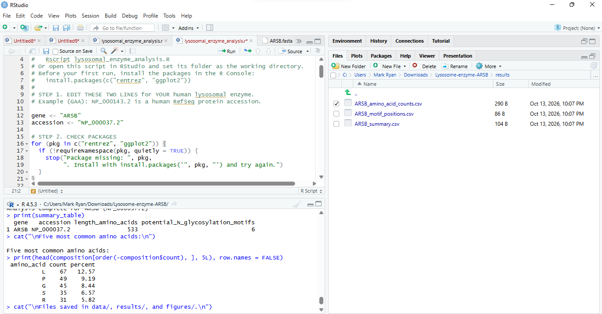

## 1. Enzyme Information

- **Enzyme Name:** arylsulfatase B 
- **Gene Symbol:** ARSB
- **NCBI Protein Record:** NP_000037.2 (https://www.ncbi.nlm.nih.gov/protein/38569405)
## 2. Biological Function
- Arylsulfatase B belongs to the sulfatase family. It hydrolyzes sulfate groups of N-Acetyl-D-galactosamine, chondriotin sulfate, and dermatan sulfate. ARSB deficiency causes mucopolysaccharidosis type VI (MPS VI), also known as Maroteaux-Lamy syndrome, an autosomal recessive lysosomal storage disorder.
## 3. Step by step workflow
The whole analysis was run in RStudio (R 4.3.2) using lysosomal_enzyme_analysis.R. The sequence was downloaded from NCBI by the script itself (using the rentrez package), not copied by hand. Each step below shows the code, then the actual output I got.
### Step 1. Choose the enzyme and record the accession
The chosen enzyme was arylsulfatase B (ARSB), specifically from the organism *Homo sapiens*. The protein selected for analysis was arylsulfatase B isoform 1 precursor, also known as N-acetylgalactosamine-4-sulfatase. Its NCBI protein accession number is NP_000037.2, which was used as the reference for the protein sequence and subsequent analyses.
### Step 2. Edit the two lines at the top of the script
```r
gene <- "ARSB"
accession <- "NP_000037.2"
```
### Step 3. Install packages (once) and check them
```r
install.packages(c("rentrez", "ggplot2"))
```
### Step 4. Download the protein sequence from NCBI through R
```r
fasta <- rentrez::entrez_fetch(
  db = "protein",
  id = accession,
  rettype = "fasta",
  retmode = "text"
)

writeLines(fasta, file.path("data", paste0(gene, ".fasta")))
```
This calls the NCBI Protein database using the ARSB accession and saves the retrieved sequence as `data/ARSB.fasta`. The accession used is `NP_000037.2`, corresponding to arylsulfatase B isoform 1 precursor from *Homo sapiens*.

The first lines of the downloaded file should contain the NCBI FASTA header followed by the amino acid sequence, for example:
```text
>NP_000037.2 arylsulfatase B isoform 1 precursor [Homo sapiens]
MGPRGAASLPRGPGPRRLLLPVVLPLLLLLLLAPPGSGAGASRPPHLVFLLADDLGWNDVGFHGSRIRTP
HLDALAAGGVLLDNYYTQPLCTPSRSQLLTGRYQIRTGLQHQIIWPCQPSCVPLDEKLLPQLLKEAGYTT
...
```
The header should be checked against the NCBI protein record to confirm that the downloaded sequence corresponds to ARSB.

The R console screenshot below can be used to document the sequence download process:

### Step 5. Count the sequence length and amino acids
The amino acid sequence was split into individual residues in R, and the total protein length and amino acid frequencies were calculated.
```r
amino_acids <- strsplit(protein, "", fixed = TRUE)[[1]]
protein_length <- length(amino_acids)
counts <- table(factor(amino_acids, levels = standard_aa))
```
**Result:** The ARSB protein sequence contains **533 amino acids**, consistent with the NCBI protein record for arylsulfatase B isoform 1 precursor (NP_000037.2).

The five most abundant amino acids based on the calculated counts and percentages were:

```text
 amino_acid  count  percent
          L     67    12.57
          P     49     9.19
          G     45     8.44
          S     35     6.57
          R     31     5.82
```

Leucine was the most abundant amino acid, accounting for 12.57% of the sequence, followed by proline at 9.19% and glycine at 8.44%. These results describe the amino acid composition of the analyzed ARSB protein sequence.

The complete counts for all 20 standard amino acids are saved in `results/ARSB_amino_acid_counts.csv`.
### Step 6. Search for potential N-glycosylation motifs

```r
positions <- i[amino_acids[i] == "N" &
               amino_acids[i + 1L] %in% setdiff(standard_aa, "P") &
               amino_acids[i + 2L] %in% c("S", "T")]
```

The code identifies potential N-glycosylation motifs following the N-X-S/T pattern, where X is any standard amino acid except proline.

The analysis found 6 potential motifs at positions 188, 279, 291, 366, 426, and 458.

```text
  gene   accession length_amino_acids potential_N_glycosylation_motifs
1 ARSB   NP_000037.2               533                                6
```

These positions were checked against the protein sequence. They represent potential glycosylation sites, not confirmed glycosylation.
### Step 7. Save the tables and make the figures

The script saved three CSV files in `results/` and two figures in `figures/`. The console confirmed completion with `Files saved in data/, results/, and figures/.`.

### Output files

| Step | File produced |
|---|---|
| 4 | `data/ARSB.fasta` |
| 5–6 | `results/ARSB_summary.csv`, `results/ARSB_amino_acid_counts.csv`, `results/ARSB_motif_positions.csv` |
| 7 | `figures/01_ARSB_amino_acid_composition.png`, `figures/02_ARSB_potential_N_glycosylation.png` |

## Results

**Summary** (`results/ARSB_summary.csv`)

| gene | accession | length_amino_acids | potential_N_glycosylation_motifs |
|---|---|---:|---:|
| ARSB | NP_000037.2 | 533 | 6 |

**Potential N-glycosylation motifs** (`results/ARSB_motif_positions.csv`)

| position | motif |
|---:|---|
| 188 | NVT |
| 279 | NVT |
| 291 | NNT |
| 366 | NGT |
| 426 | NTS |
| 458 | NVS |

**Amino acid counts** (`results/ARSB_amino_acid_counts.csv`)

| amino_acid | count | percent |
|---|---:|---:|
| A | 30 | 5.63 |
| C | 9 | 1.69 |
| D | 29 | 5.44 |
| E | 21 | 3.94 |
| F | 18 | 3.38 |
| G | 45 | 8.44 |
| H | 20 | 3.75 |
| I | 19 | 3.56 |
| K | 23 | 4.32 |
| L | 67 | 12.57 |
| M | 8 | 1.50 |
| N | 21 | 3.94 |
| P | 49 | 9.19 |
| Q | 15 | 2.81 |
| R | 31 | 5.82 |
| S | 35 | 6.57 |
| T | 29 | 5.44 |
| V | 28 | 5.25 |
| W | 14 | 2.63 |
| Y | 22 | 4.13 |

## 4. Figures
### Figure 1. Amino Acid Composition of ARSB


### Figure 2. Potential N-Glycosylation Sites in ARSB


## 5. Laboratory Questions and Answers
### 1. What does your enzyme normally break down inside lysosomes?
Arylsulfatase B (ARSB), also known as N-acetylgalactosamine-4-sulfatase, removes sulfate groups from specific molecules, particularly dermatan sulfate and chondroitin sulfate. This activity is important for the normal degradation and recycling of these complex carbohydrates inside lysosomes.

### 2. What is the total length of your protein, and which amino acids are most common?
The human ARSB isoform 1 precursor contains 533 amino acids. Based on the NCBI protein sequence, the most abundant amino acids are leucine (67 residues), proline (49 residues), and glycine (45 residues).A total of **six potential N-glycosylation motifs** were identified in the ARSB protein sequence. They are located at amino acid positions 188 (NVT), 279 (NVT), 291 (NNT), 366 (NGT), 426 (NTS), and 458 (NVS).

### 3. How many potential N-glycosylation motifs did you find? Where are they located?
These motifs follow the consensus sequence N-X-S/T, where N is asparagine, X can be any amino acid except proline, and S/T represents serine or threonine. These sequences indicate potential sites for N-linked glycosylation, but their presence alone does not confirm that glycosylation actually occurs.

### 4. Why can glycosylation matter for lysosomal proteins? Does finding a motif prove the protein is glycosylated?
Glycosylation can help lysosomal proteins fold correctly, maintain stability, and undergo proper intracellular trafficking. In ARSB, glycosylation may contribute to the proper maturation and function of the enzyme. However, finding a potential N-glycosylation motif does not prove that the protein is actually glycosylated at that site. The motif only indicates a possible site for glycosylation, and experimental evidence is needed to confirm whether the modification occurs.

### 5. What could happen in the cell if your enzyme did not work properly?
If ARSB does not function properly, the breakdown of dermatan sulfate and chondroitin sulfate becomes impaired. These molecules can accumulate in lysosomes, disrupting normal cellular function and contributing to tissue and organ damage. In humans, inherited ARSB deficiency causes mucopolysaccharidosis type VI (MPS VI), also known as Maroteaux-Lamy syndrome.
