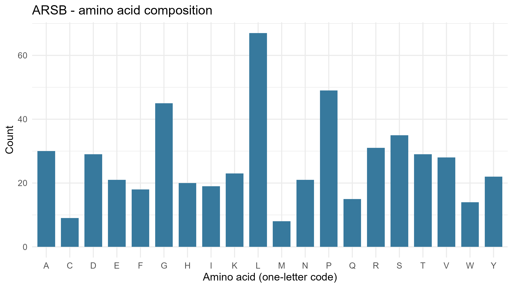
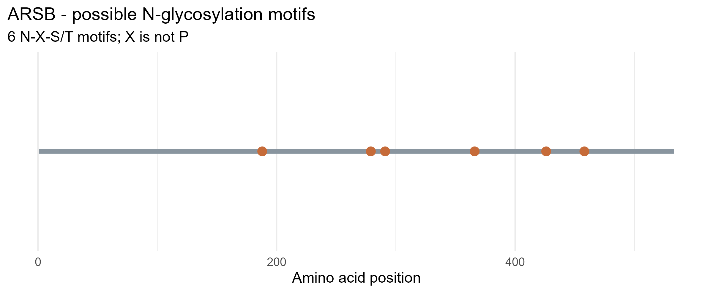

## 1. Enzyme Information

- **Enzyme Name:** arylsulfatase B 
- **Gene Symbol:** ARSB
- **NCBI Protein Record:** NP_000037.2 (https://www.ncbi.nlm.nih.gov/protein/38569405)
## 2. Biological Function
- Arylsulfatase B belongs to the sulfatase family. It hydrolyzes sulfate groups of N-Acetyl-D-galactosamine, chondriotin sulfate, and dermatan sulfate. ARSB deficiency causes mucopolysaccharidosis type VI (MPS VI), also known as Maroteaux-Lamy syndrome, an autosomal recessive lysosomal storage disorder.
## 3. Figures
### Figure 1. Amino Acid Composition of ARSB

### Figure 2. Potential N-Glycosylation Sites in ARSB

## 4. Laboratory Questions and Answers
### 1. What does your enzyme normally break down inside lysosomes?
Arylsulfatase B (ARSB), also known as N-acetylgalactosamine-4-sulfatase, removes sulfate groups from specific molecules, particularly dermatan sulfate and chondroitin sulfate. This activity is important for the normal degradation and recycling of these complex carbohydrates inside lysosomes.

### 2. What is the total length of your protein, and which amino acids are most common?
The human ARSB isoform 1 precursor contains 533 amino acids. Based on the NCBI protein sequence, the most abundant amino acids are leucine (67 residues), proline (49 residues), and glycine (45 residues).A total of **six potential N-glycosylation motifs** were identified in the ARSB protein sequence. They are located at amino acid positions 188 (NVT), 279 (NVT), 291 (NNT), 366 (NGT), 426 (NTS), and 458 (NVS).

### 3. How many potential N-glycosylation motifs did you find? Where are they located?
These motifs follow the consensus sequence N-X-S/T, where N is asparagine, X can be any amino acid except proline, and S/T represents serine or threonine. These sequences indicate potential sites for N-linked glycosylation, but their presence alone does not confirm that glycosylation actually occurs.

### 4. Why can glycosylation matter for lysosomal proteins? Does finding a motif prove the protein is glycosylated?
Glycosylation can help lysosomal proteins fold correctly, maintain stability, and undergo proper intracellular trafficking. In ARSB, glycosylation may contribute to the proper maturation and function of the enzyme. However, finding a potential N-glycosylation motif does not prove that the protein is actually glycosylated at that site. The motif only indicates a possible site for glycosylation, and experimental evidence is needed to confirm whether the modification occurs.

### 5. What could happen in the cell if your enzyme did not work properly?
If ARSB does not function properly, the breakdown of dermatan sulfate and chondroitin sulfate becomes impaired. These molecules can accumulate in lysosomes, disrupting normal cellular function and contributing to tissue and organ damage. In humans, inherited ARSB deficiency causes mucopolysaccharidosis type VI (MPS VI), also known as Maroteaux-Lamy syndrome.
